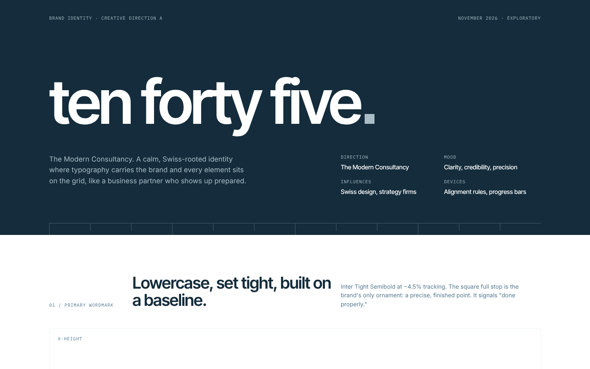
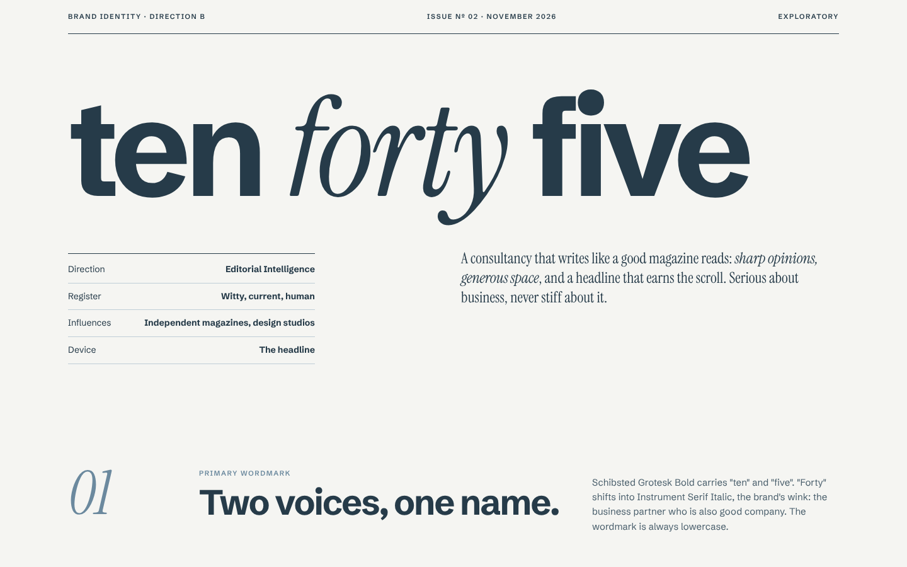
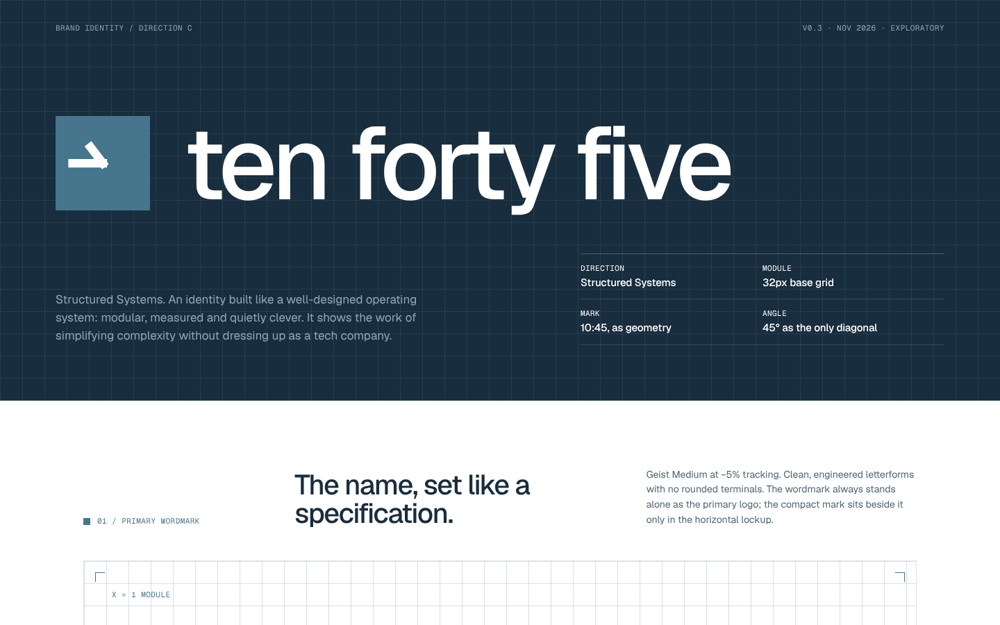

# ten forty five

Brand identity exploration for **ten forty five**, a business growth partner.

## Brand mockups (November 2026)

Three creative directions, built from the master brief in [`brief/`](brief/brand-identity-design-prompts.md). Each board covers all 15 deliverables: wordmark, secondary and compact marks, light/dark versions, colour, typography, graphic elements, art direction, business cards, Instagram carousel, LinkedIn templates, digital ads, proposal and workbook covers, website hero, and usage guidelines.

| | Direction | Board | Preview |
|---|---|---|---|
| A | The Modern Consultancy | [`a-modern-consultancy.html`](brand-mockups/a-modern-consultancy.html) | [full board](brand-mockups/previews/a-modern-consultancy.jpg) |
| B | Editorial Intelligence | [`b-editorial-intelligence.html`](brand-mockups/b-editorial-intelligence.html) | [full board](brand-mockups/previews/b-editorial-intelligence.jpg) |
| C | Structured Systems | [`c-structured-systems.html`](brand-mockups/c-structured-systems.html) | [full board](brand-mockups/previews/c-structured-systems.jpg) |

Start at [`brand-mockups/index.html`](brand-mockups/index.html) for the side-by-side comparison and recommendation.

### Viewing

The boards are self-contained HTML files. Open them in a browser; they load fonts from Google Fonts. They are responsive down to phone width.

### Notes

- Palettes are exploratory, as given in the brief, and not yet approved.
- Photography panels are tonal and compositional studies, not final imagery.
- Names, clients and figures in the mockups are placeholders.
