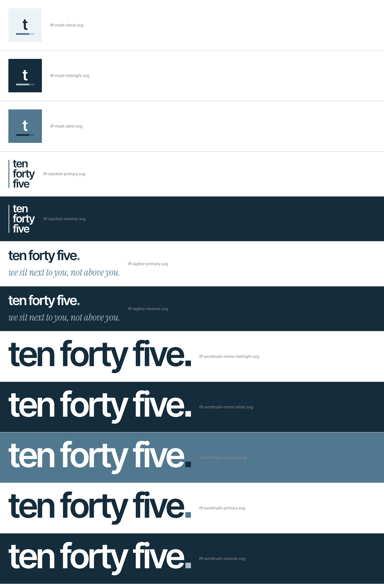

# ten forty five: brand kit v1.0

The approved brand identity for **ten forty five** (November 2026), packaged for designers, developers and Claude Design.


## Start here

| If you want to… | Open |
|---|---|
| See the whole identity | [`brand-board.html`](brand-board.html) or [`previews/brand-board.jpg`](previews/brand-board.jpg) |
| Brief Claude Design (or any designer) | [`claude-design-brief.md`](claude-design-brief.md) |
| Know the rules | [`guidelines.md`](guidelines.md) |
| Grab a logo | [`logos/`](logos/) |
| Build a website or app | [`tokens/`](tokens/) |
| Make a post, ad, card or cover | [`templates/`](templates/) |

## Contents

```
brand-kit/
├── README.md                 this file
├── guidelines.md             the brand rules: logo, colour, type, layout, imagery, voice
├── claude-design-brief.md    paste-ready brief for Claude Design
├── brand-board.html          full visual identity board (open in a browser)
├── logos/
│   ├── svg/                  outlined vector logos (no fonts needed)
│   ├── png/                  transparent PNGs: wordmarks at 800 and 2400px wide, marks at 32 to 1024px
│   └── favicon/              favicon.ico, favicon.svg, apple-touch-icon, 192 and 512 icons
├── tokens/
│   ├── tokens.json           design tokens (W3C Design Tokens format)
│   ├── tokens.css            CSS variables and helper classes (.tff-wordmark, .tff-accent, .tff-btn …)
│   ├── fonts.css             @font-face rules for the bundled fonts
│   └── tailwind.preset.js    Tailwind theme preset
├── fonts/                    Inter Tight, Inter, IBM Plex Mono, Instrument Serif (SIL OFL)
├── templates/                business card, Instagram carousel, LinkedIn, ads, proposal, workbook, web hero
├── previews/                 PNG previews of the logos and templates
└── scripts/                  rebuild logos (build_logos.py) and PNGs (export_png.js)
```

## Logos at a glance



| File | Background |
|---|---|
| `tff-wordmark-primary` | White or cloud |
| `tff-wordmark-reverse` | Midnight |
| `tff-wordmark-on-steel` | Steel |
| `tff-wordmark-mono-midnight` / `-mono-white` | One-colour use |
| `tff-stacked-primary` / `-reverse` | Tall formats |
| `tff-tagline-primary` / `-reverse` | With "we sit next to you, not above you." |
| `tff-mark-midnight` / `-steel` / `-cloud` | Avatars, app icons, favicons |

## Colours

| Midnight | Steel | Mist | Cloud | White |
|---|---|---|---|---|
| `#142C3B` | `#52788F` | `#A9BDC9` | `#EDF2F5` | `#FFFFFF` |

## Using the tokens on a website

```html
<link rel="stylesheet" href="brand-kit/tokens/fonts.css">
<link rel="stylesheet" href="brand-kit/tokens/tokens.css">

<h1 class="tff-display">We sit next to you, <span class="tff-accent" style="color:var(--tff-steel)">not above you.</span></h1>
<a class="tff-btn" href="/contact">Book a growth call</a>
```

For Tailwind, add `presets: [require('./brand-kit/tokens/tailwind.preset.js')]` to your config.

## Using the templates

Open any file in `templates/` in a browser. Each canvas is drawn at its real output size (some are scaled down on screen and say so). Edit the text in the HTML, then screenshot the canvas, or print the A4 covers to PDF. All templates read from `tokens/` and `logos/`, so they stay on-brand.

## Rebuilding the logos

The SVGs are generated from the font files, so they stay exact:

```bash
pip install fonttools uharfbuzz
python3 brand-kit/scripts/build_logos.py
node brand-kit/scripts/export_png.js   # needs Playwright
```

## Licences

The fonts are licensed under the SIL Open Font License 1.1 (see `fonts/OFL-*.txt`). The logos and brand assets belong to ten forty five.
